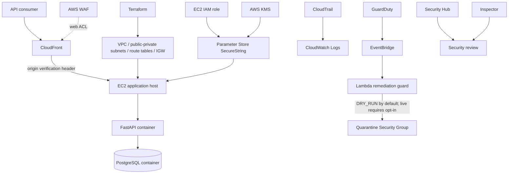

# SecureCloudOps

**Secure & Automated Cloud Infrastructure — Cloud Engineering and Cloud Security portfolio project.**

SecureCloudOps starts with a small FastAPI/PostgreSQL workload, containerizes it with Docker Compose, provisions an AWS network with Terraform, deploys the workload to EC2, and adds layered security monitoring plus a guarded, event-driven EC2 isolation workflow.

> **Verified safe/demo state (9 Nov 2026):** the Phase 10 Lambda is `Active` with `DRY_RUN=true`; the production EventBridge rule is `DISABLED`; the EC2 application instance is `stopped`, retains its original Security Group, and has no `SecureCloudOpsAutoRemediate=true` opt-in tag. The quarantine Security Group exists with no ingress or egress rules. Live isolation has **not** been executed.

## Why this project

This project demonstrates a practical cloud-security workflow rather than only a collection of AWS services:

1. Build and test a real API workload locally.
2. Containerize it and define AWS network resources as code.
3. Deploy the workload to an EC2 host and retrieve runtime secrets through IAM + Systems Manager Parameter Store.
4. Put CloudFront/WAF in front of the origin and verify requests with an origin header.
5. Enable audit/monitoring and managed detection services.
6. Route a GuardDuty finding through EventBridge into a Lambda guard that validates the event and can isolate only an explicitly opted-in EC2 instance.

## Architecture



Detailed design and trust boundaries: [docs/ARCHITECTURE.md](docs/ARCHITECTURE.md).

## Technology stack

| Area | Technologies |
|---|---|
| API | Python 3.12, FastAPI, Uvicorn |
| Data | PostgreSQL 16, SQLAlchemy 2, psycopg |
| Tests / quality | pytest, Ruff |
| Packaging | Docker, Docker Compose |
| Infrastructure as Code | Terraform, AWS provider |
| Workload / identity | EC2, VPC, Security Groups, IAM role, Systems Manager Parameter Store, KMS |
| Edge / audit | CloudFront, AWS WAF, CloudTrail, CloudWatch |
| Detection | GuardDuty, Security Hub, Inspector |
| Event-driven response | EventBridge, AWS Lambda, quarantine Security Group |
| CI/CD | GitHub Actions, AWS OIDC, Systems Manager Run Command |

## Repository layout

```text
securecloudops/
├── app/                         # FastAPI application, data models and DB session
├── tests/                       # API tests
├── docs/                        # Phase notes, architecture, runbook and evidence
├── infra/                       # Terraform network reference configuration
├── end phase/                   # GuardDuty/EventBridge/Lambda source + safe templates
├── scripts/                     # Read-only AWS final-state audit
├── .github/workflows/ci.yml     # CI, OIDC check and conditional EC2 deployment
├── .github/scripts/             # SSM deployment script
├── Dockerfile
├── docker-compose.yml
├── requirements.txt
├── requirements-dev.txt
├── Makefile
└── README.md
```

Local tool installations (`CLI/`), `.env`, access-key CSV files, Terraform state, provider binaries and caches are intentionally excluded from version control. `.env.example` contains dummy local-development values only.

## Run locally (Windows PowerShell)

Prerequisites: Python 3.12, Docker Desktop using the Linux engine, and Git.

```powershell
# Run from the repository root
Copy-Item .env.example .env
# Review .env. Values are local-only dummy values; do not reuse them in AWS.
docker compose up --build -d
docker compose ps
Invoke-WebRequest http://localhost:8000/health -UseBasicParsing
```

Open Swagger at `http://localhost:8000/docs`.

Run tests inside the API container:

```powershell
docker compose exec api pytest -q
```

Stop containers:

```powershell
docker compose down
```

Remove the local PostgreSQL volume only when you intentionally want to delete its data:

```powershell
docker compose down -v
```

For running Uvicorn directly on the host, use a host-reachable database URL (`localhost`, not the Compose service name `db`) and ensure PostgreSQL is running locally. See [docs/PROJECT_GUIDE_VI.md](docs/PROJECT_GUIDE_VI.md).

## Test and deployment workflow

- GitHub Actions runs the Python tests and builds the Docker image.
- An OIDC check can verify GitHub Actions access to AWS.
- EC2 deployment through SSM is conditional on repository variable `ENABLE_EC2_DEPLOY=true` and the required AWS repository variables. A workflow job has previously been observed as skipped when the condition was not enabled; inspect the latest Actions run rather than assuming every push deploys.
- The deployment script retrieves the database password and origin-verification token from Parameter Store at runtime. Do not put those values in GitHub source, workflow YAML or screenshots.

## Security workflow and verified evidence

| Phase | What it adds | Evidence / caveat |
|---|---|---|
| 1–4 | Local API, Docker, network foundation, Terraform and API verification | Local workload and Terraform workflow established |
| 5 | EC2-hosted container workload | `/health` previously returned HTTP 200; EC2 is currently stopped |
| 6 | IAM role, KMS and Parameter Store SecureString | Secret retrieval and least-privilege behavior tested |
| 7 | GitHub Actions, OIDC and conditional SSM deployment | CI/build configured; review the actual latest deploy job status |
| 8 | CloudFront/WAF, CloudTrail and CloudWatch visibility | Origin verification returned 403 without token and 200 with token |
| 9 | GuardDuty, Security Hub and Inspector | Services enabled/configured; review usage and coverage costs |
| 10 | EventBridge + Lambda guarded remediation | Direct tests and GuardDuty sample integration passed with `DRY_RUN=true` |

See [docs/PHASES.md](docs/PHASES.md), [docs/TEST_EVIDENCE.md](docs/TEST_EVIDENCE.md) and [docs/RUNBOOK.md](docs/RUNBOOK.md) for exact test outcomes and limitations.

## Phase 10 safety contract

The Lambda handler validates the expected account, region, finding type/severity, sample status, target instance, VPC, network-interface count, opt-in tag and quarantine Security Group before a potential live change. It skips sample findings. In live mode it stores the original Security Group IDs on the instance before replacing the current groups.

**Do not set `DRY_RUN=false` or enable the production EventBridge rule just to make a demo look complete.** A deny-all quarantine Security Group may remove all network access, including administration. Live remediation requires a dedicated test window, explicit approval and a rehearsed rollback.

## Known limitations — be accurate in interviews

- The verified workload is EC2 + Docker Compose; this repository should not be described as an ECS + RDS deployment.
- The EC2 `/health` endpoint was healthy during a prior check, but the instance is currently stopped.
- The Phase 10 event flow was integration-tested using a GuardDuty sample finding; the Lambda correctly skipped it. The function was also directly tested with a synthetic eligible event in dry-run mode.
- A live security-group replacement/quarantine was not performed.
- The production EventBridge rule was restored and left disabled after testing.
- The EC2/SSM deploy job is conditional; confirm a successful latest Actions run before claiming continuous automatic deployment.
- The environment is a learning/portfolio lab, not a production-hardened HA, compliance-certified or disaster-recovery solution.

## Documentation

- [All ten phases](docs/PHASES.md)
- [Architecture and design](docs/ARCHITECTURE.md)
- [Vietnamese project guide](docs/PROJECT_GUIDE_VI.md)
- [Test evidence](docs/TEST_EVIDENCE.md)
- [Operations runbook](docs/RUNBOOK.md)
- [Cost and cleanup checklist](docs/COST_AND_CLEANUP.md)
- [Portfolio and interview notes](docs/PORTFOLIO.md)
- [Publishing and secret-handling checklist](SECURITY_PUBLISHING.md)
- [Terraform network notes](infra/README.md)

## Security hygiene before publishing

- Never commit `.env`, access-key CSVs, AWS credentials, private keys, Terraform state, local Terraform provider binaries or raw CloudWatch logs.
- Rotate any credential that has been shared outside its intended secret store.
- Restrict SSH (TCP 22) to a trusted source before restarting the EC2 host; the lab Security Group was previously observed with broad SSH ingress.
- Keep the CloudFront origin verification token in Parameter Store and out of GitHub.
- Use GitHub OIDC instead of long-lived AWS access keys for CI/CD.
