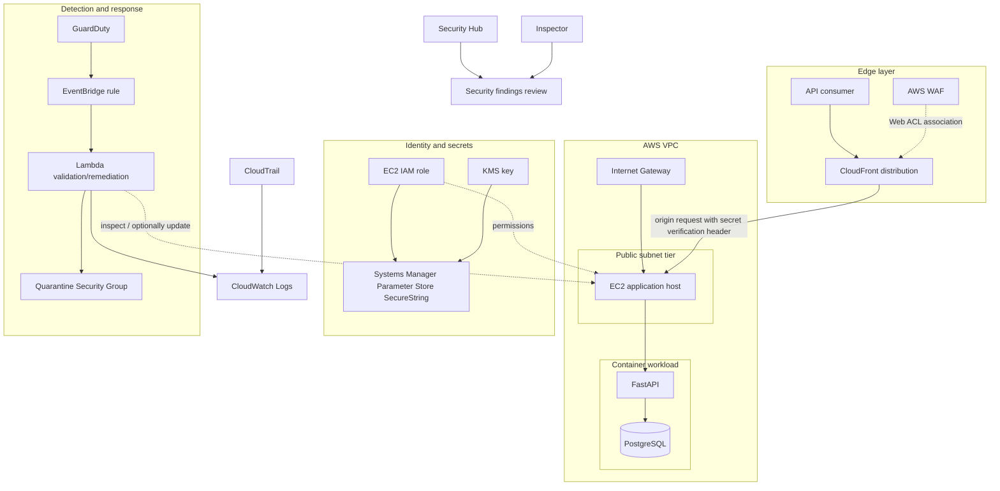
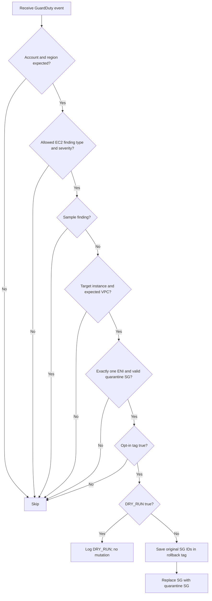

# Architecture and design

## Logical view

## Network model

- VPC CIDR: `10.0.0.0/16`.
- The Terraform design contains two public and two private subnet resources with route tables and an Internet Gateway.
- Workload instance: `<EC2_INSTANCE_ID>`, VPC `<VPC_ID>`, subnet `subnet-079d1049aa6e8f60e`.
- Do not infer that private workloads are currently deployed merely because private subnets exist in Terraform.
- The instance security group previously included SSH ingress and application ingress. Restrict SSH to a trusted CIDR before restarting or exposing the host.

## Trust boundaries

1. **Internet → CloudFront:** public entry point; WAF is intended to inspect/filter requests.
2. **CloudFront → origin:** origin verification header is used to prevent direct requests that lack the expected token. The observed test was 403 without the token and 200 with it.
3. **EC2 → AWS APIs:** use the instance role and Parameter Store rather than embedding long-lived credentials or passwords in the image.
4. **GuardDuty → EventBridge:** the production event pattern limits the trigger to the expected account, finding types/severity and target EC2 instance.
5. **EventBridge → Lambda:** Lambda resource policy permits the specified EventBridge rule to invoke the function.
6. **Lambda → EC2:** fail-closed checks and the `SecureCloudOpsAutoRemediate=true` opt-in tag gate the potential network isolation operation.

## Phase 10 decision sequence

## Important design choices

- **Opt-in, not opt-out:** only explicitly tagged instances are eligible for remediation.
- **Sample findings are skipped:** sample events validate integration without isolating a host.
- **Dry-run default:** lets the team validate event delivery and guard conditions without changing networking.
- **Dedicated quarantine SG:** zero ingress and zero egress is a clear deny-all isolation profile.
- **Rollback metadata:** the function records original security-group IDs before switching the instance to quarantine.

## Current architecture boundary

The current verified workload is EC2 with Docker Compose containers, not a confirmed ECS/RDS production deployment. Keep diagrams and interview descriptions aligned with the resources actually provisioned in the account.
